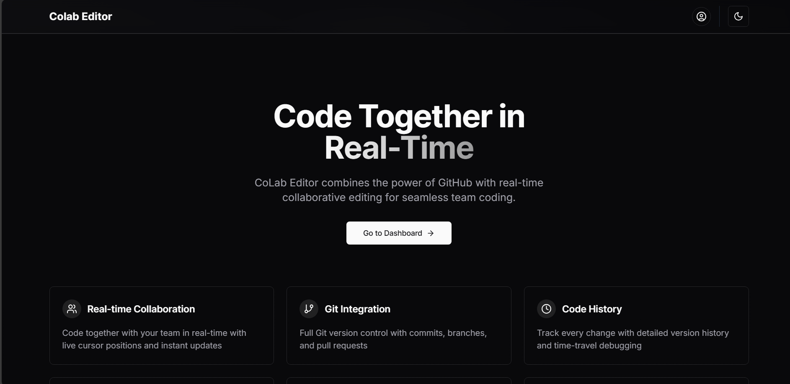
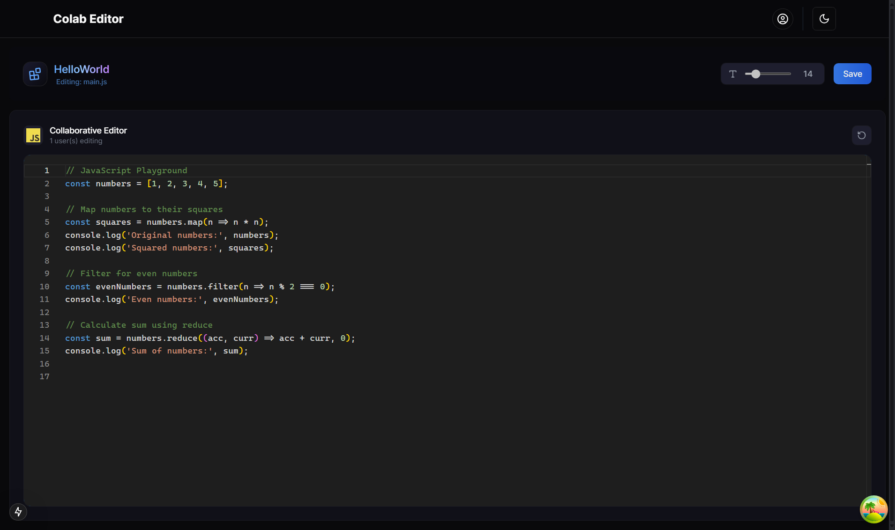
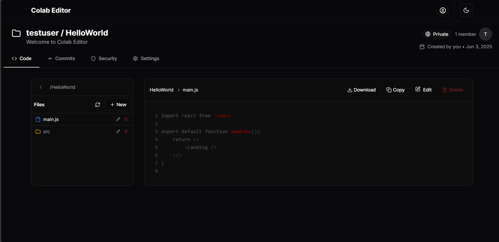

# 🧠 Collab Editor

A real-time, GitHub-like collaborative code editor built with **Next.js**, **Supabase**, and **React Query**. It supports OAuth login, versioned project structure, live VS Code-style file editing, and file system with folders and commits.

---

## 🚀 Features

### 🔐 Authentication
- OAuth login using Supabase (Google/GitHub)
- Secure session handling and access control

### 🏠 Landing Page
- Clean, responsive design with theme toggle
- Built using **shadcn/ui** and **Magic UI**

### 📁 GitHub-Style Project Structure
- Create projects with folders and files
- Hierarchical file tree with directory and file support
- Metadata stored and versioned in Supabase

### 💻 Live Editor
- Real-time collaborative editing (Monaco-based) over Supabase Realtime
- Live presence: see who is in a file, with their cursors and selections
- VS Code-style layout with syntax highlighting
- Code suggestions and language mode support
- Commit straight from the editor with a message (`Ctrl/Cmd + S`)

### 📝 Commit History
- Every create, edit, rename and delete is recorded as a commit
- Browse the repository as it was at any commit
- View commit logs for projects
- Structured using `commits`, `file_changes`, and `file_tree` tables in Supabase

### ✨ UX Enhancements
- Dark/light theme toggle
- Responsive layout
- Realtime sync with database via React Query

---

## 🛠 Tech Stack

| Layer      | Technologies                             |
|------------|------------------------------------------|
| Frontend   | Next.js, React, React Query              |
| Backend    | Supabase (PostgreSQL, Auth, Storage)     |
| UI/UX      | Tailwind CSS, shadcn/ui, Magic UI        |
| Editor     | Monaco Editor (VS Code-like experience)  |
| Auth       | Supabase OAuth                           |
| State Mgmt | React Query                              |

---

## 📸 Screenshots

| Landing Page | Editor View | File Tree |
|--------------|-------------|-----------|
|  |  |  |

---

## 🌐 Live Demo

🔗 [colab-editor.vercel.app](https://colab-editor.vercel.app)

---

## 📦 Getting Started

### 1. Clone the Repository

```bash
git clone https://github.com/ajs1109/colab-editor.git
cd colab-editor
```

### 2. Install Dependencies

```bash
npm install
```

### 3. Set Environment Variables

```bash
cp .env.example .env.local
```

Fill in your Supabase URL and anon key (Project Settings → API) and a Resend API key (used for project invitation emails). Never commit real keys.

### 4. Set Up Supabase

1. **Database**: run `supabase/migrations/0001_versioned_files.sql` in the Supabase SQL editor (or with `supabase db push`). It creates the `commits`, `file_tree` and `file_changes` tables if they are missing and adds the `is_deleted` column the file history relies on. It is safe to run on an existing database.
2. **Auth**: enable the GitHub and Google providers under Authentication → Providers and add `http://localhost:3000/auth/callback` (plus your production URL) to the redirect URLs.
3. **Realtime**: nothing to configure. Live editing uses Realtime broadcast and presence channels, which are on by default.

### 5. Run the Development Server

```bash
npm run dev
```

The app will be available at http://localhost:3000.

## 🧩 How It Works

- **Versioned files**: each commit stores a `file_tree` row only for the paths it changed. A repository's state at any commit is the newest row for each path at or before that commit, and deleted paths are stored as tombstones (`is_deleted = true`). All of this lives in `src/utils/supabase/repo-files.ts`.
- **Saving**: the explorer and the editor both send changes to `POST /api/repo/[username]/[repo]/commits`. This route checks that the signed-in user has write access and records the change as a commit.
- **Live editing**: `src/hooks/useCollaboration.ts` joins a Supabase Realtime channel per file. Edits are broadcast as Monaco deltas, presence carries each user's cursor and selection, and a newcomer gets the current unsaved buffer from the longest-present collaborator. Edits are relayed in arrival order with no conflict resolution (OT or CRDT), so two people typing at the same spot at the same moment can occasionally end up with different text. Saving, or reopening the file, brings everyone back to the same content.

## 🤝 Contributing
Contributions are welcome!
Please open issues or pull requests for features, bugs, or improvements.

